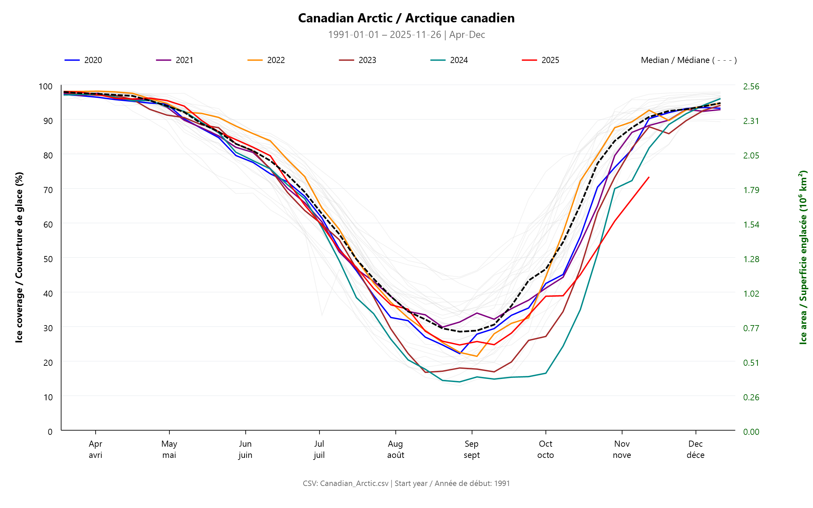
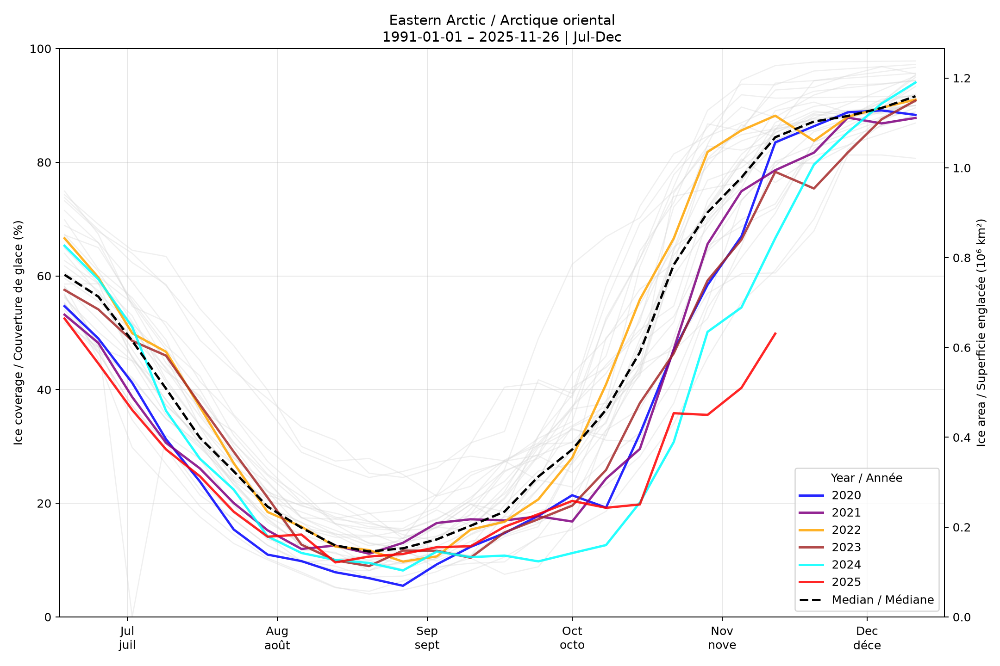
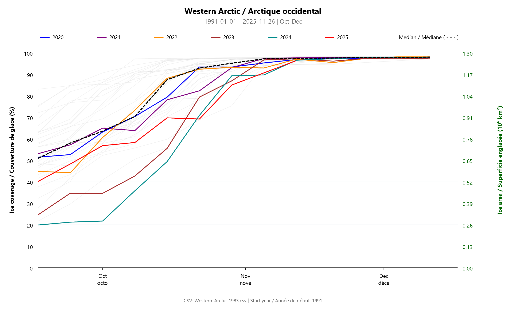
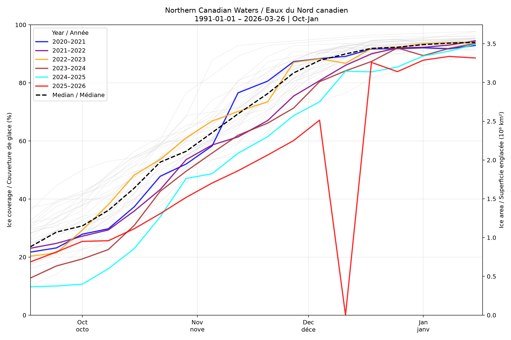
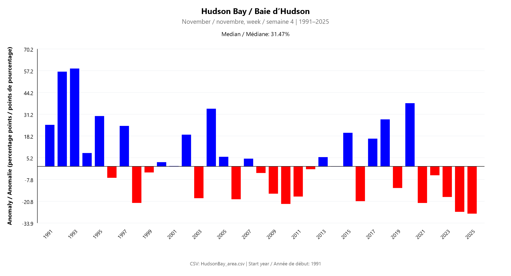
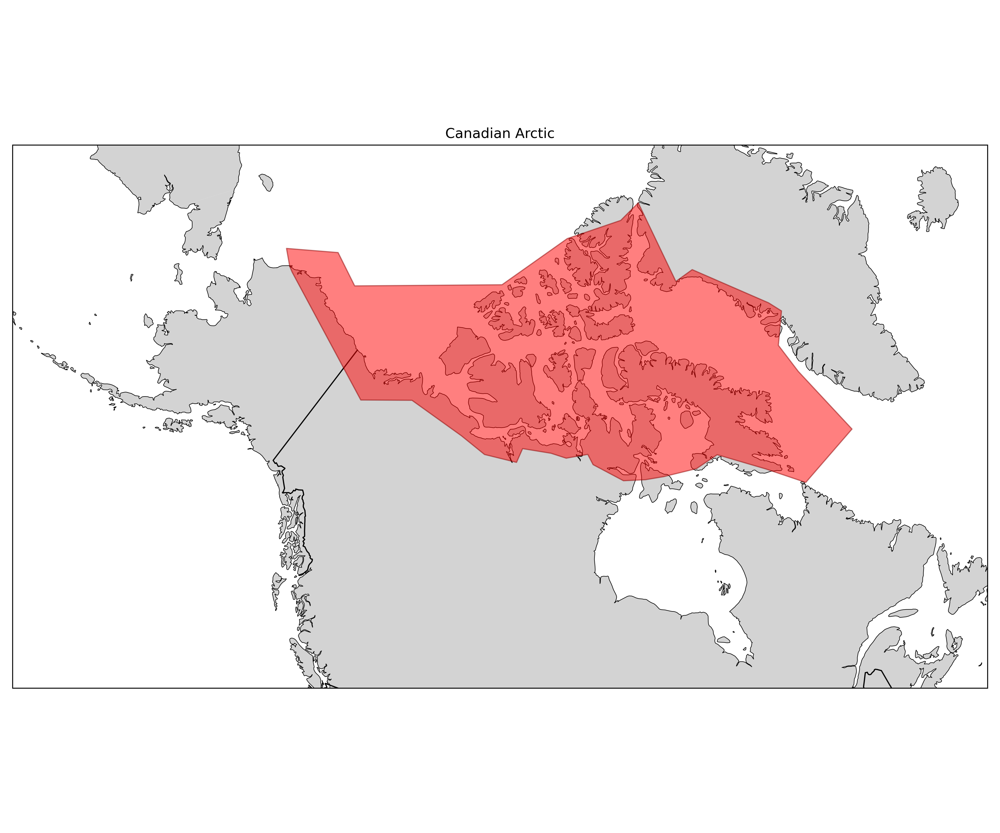
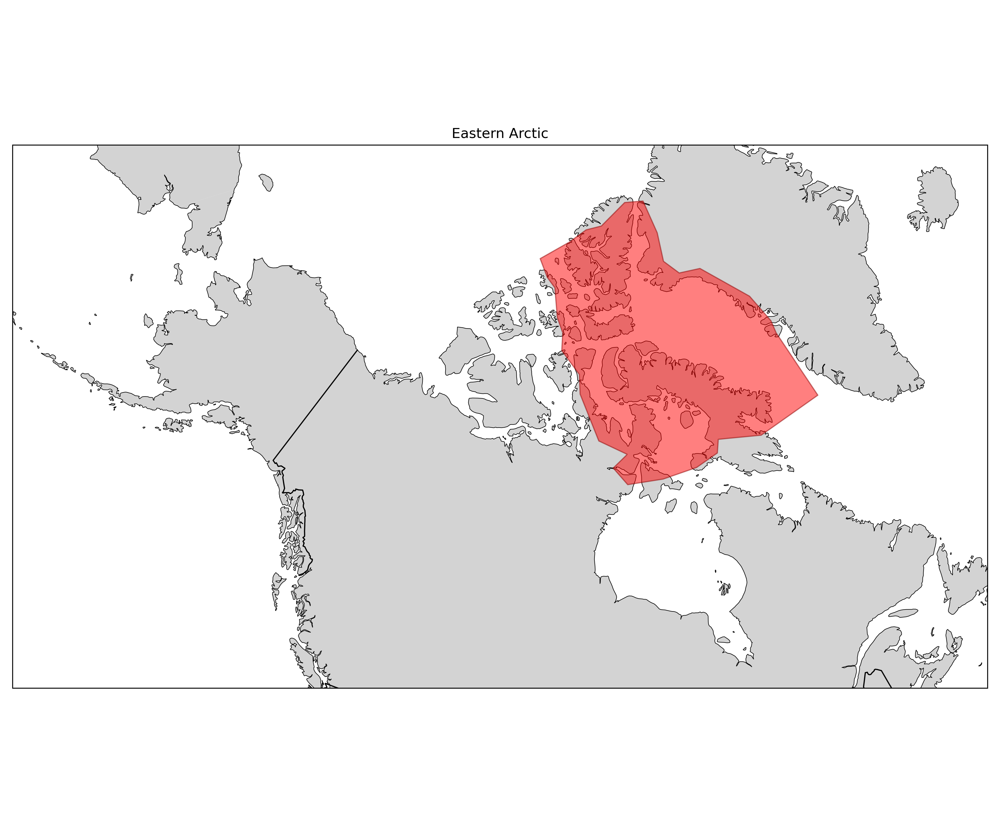
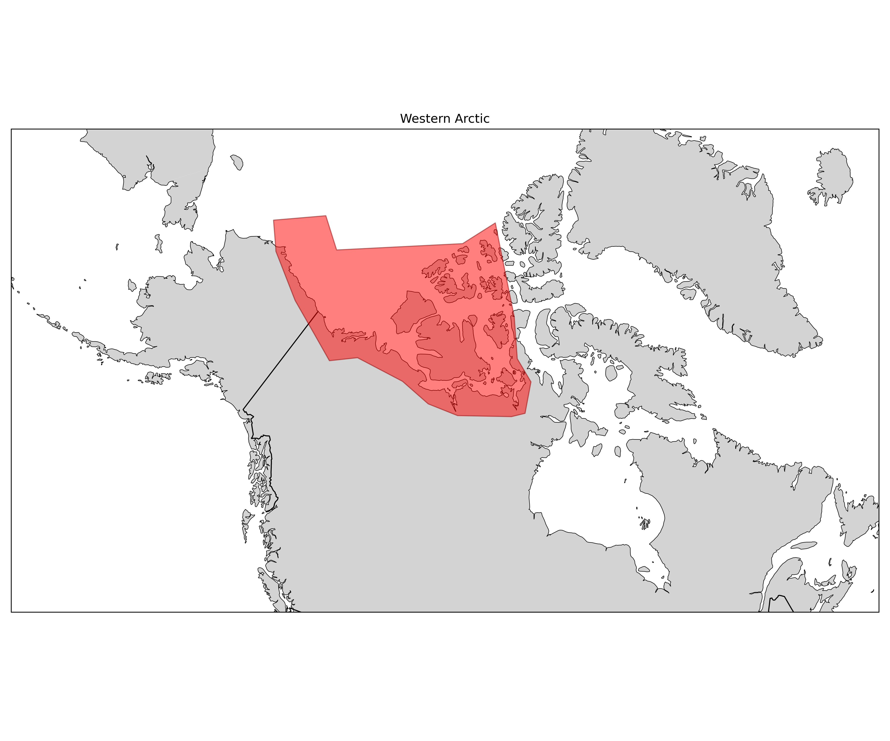
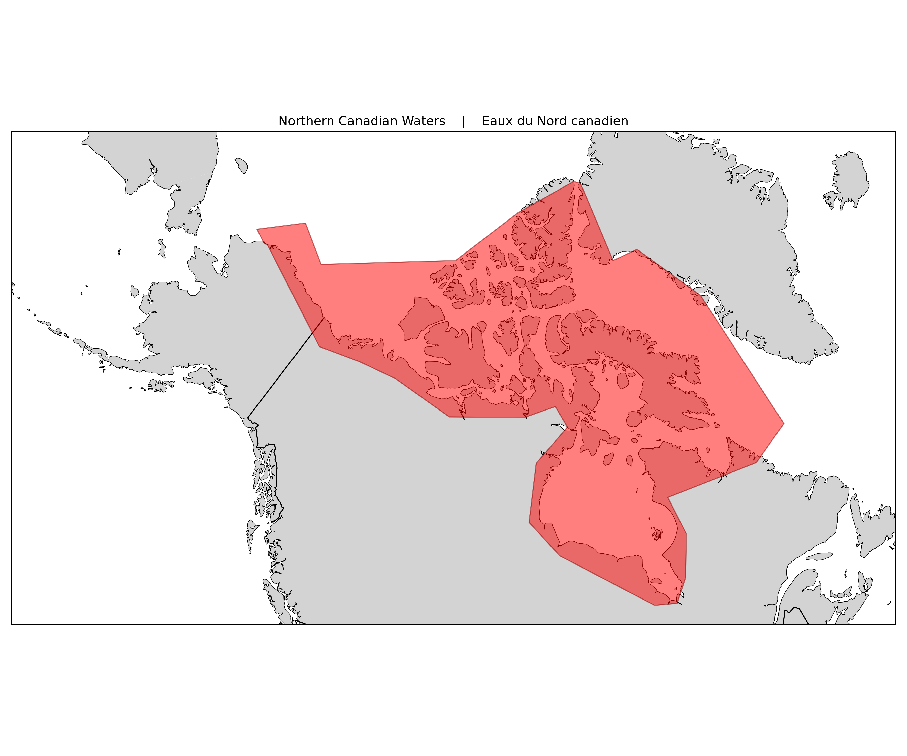

# Arctic Overlay Charts and Climatology

Historical sea ice coverage overlays, weekly anomalies, and English/French
climatology reports for five Arctic regions. Choose the start year and end date,
then generate charts and reports from the supplied CSV observations.

**[Download C# Windows app](CSharp.zip)** · **[Download Python package](Python.zip)** ·
**[C# guide](CSharp/README.md)** · **[Python guide](Python/README.md)**

## See the outputs

### Canadian Arctic — seasonal overlay

The C# application overlays historical coverage, highlights recent years, and
shows the median for the selected years. The right axis converts coverage to ice
area. This example runs from 1991 through November 26, 2025.



| Eastern Arctic — Python | Western Arctic — C# |
| --- | --- |
|  |  |
| Northern Canadian Waters — Python | Hudson Bay weekly anomalies — C# |
|  |  |

Click any preview for the full PNG. These are example outputs from the included
data, not live observations. Northern examples end March 26, 2026; the other
examples end November 26, 2025. All use start year 1991. C# and Python calculate
the same statistics but use different chart rendering.

## Choose a version

| Version | What is included | Requirements |
| --- | --- | --- |
| [C# Windows app](CSharp/) | Executable, source, build script, file browsing, chart previews, report tabs, maps and independent CSV copies | Windows with .NET Framework 4.8; no Python required |
| [Python scripts](Python/) | Regional launchers, shared analysis code, tests, maps and independent CSV copies | Python 3.10+, pandas and matplotlib |

### Run the Windows app

1. Open [CSharp.zip](CSharp.zip), click GitHub’s **Download raw file**, and extract the entire ZIP.
2. Open the extracted `CSharp` folder and double-click **ArcticOverlayCharts.exe**.
3. Select a region and CSV. Choose the start year and end date.
4. Click **Generate / Produire**. Review the charts, English/French reports and map tabs.
5. Click **Open output / Ouvrir les résultats** to view saved files.

Keep the executable, `.config`, `Data` and `Maps` together. Downloading only the
executable does not include its required inputs. [Full C# instructions](CSharp/README.md).

### Run Python

Download and extract [Python.zip](Python.zip), open a terminal in its `Python`
folder, and run:

```powershell
python -m pip install -r requirements.txt
python ".\Hudson Bay\HudsonBay-3Plots-zoomed2.py"
```

Follow the CSV, start-year and end-date prompts. Regional script names, batch
options and custom seasonal windows are in the [Python guide](Python/README.md).

## Regions and geographic coverage

| Region / Région | CSV or merge inputs |
| --- | --- |
| Canadian Arctic / Arctique canadien | Automatically combines Eastern and Western Arctic on matching dates |
| Eastern Arctic / Arctique oriental | `Eastern_Arctic-1983-area.csv` |
| Western Arctic / Arctique occidental | `Western_Arctic-1983.csv` |
| Hudson Bay / Baie d’Hudson | `HudsonBay_area.csv` |
| Northern Canadian Waters / Eaux du Nord canadien | `Northern_CDN_Waters.csv` |

| Canadian Arctic | Eastern Arctic |
| --- | --- |
|  |  |
| Western Arctic | Northern Canadian Waters |
|  |  |

These are the supplied reference maps. No Hudson Bay map was supplied. The C# app
includes a map tab; each version also includes a local `maps.html` gallery.

## Reports, data checks and calculations

- All charts and reports go into a regional `output` folder, or a destination you select.
- Every run produces separate UTF-8 English and French text reports.
- Reports end with the CSV paths, SHA-256 checksums and source row counts, so the
  exact input data can be checked.
- The selected start year applies to curves, seasonal medians, weekly statistics
  and anomaly baselines. Zero-ice observations are retained.
- Weekly statistics compare the latest observed month/week with that same week
  in available years. Multiple observations in one year/week are averaged first.
- Anomalies are percentage-point differences from the median of those yearly means.
- Seasonal medians use matching calendar dates and a fixed leap-year calendar.
- Canadian Arctic concentrations use area weights of 1,265,567 km² East and
  1,296,172 km² West. Reports disclose unmatched dates excluded from the merge.

Les deux versions permettent de choisir l’année de début et la date de fin.
Les rapports sont créés séparément en anglais et en français et indiquent les
fichiers CSV utilisés avec leurs empreintes SHA-256. Les graphiques et rapports
sont enregistrés dans les dossiers `output`.

CSV files and preview charts are snapshots. Neither version downloads updated
data automatically. Each version has its own data copies: update them independently.
See [calculation verification](VALIDATION.md) for tests and C#/Python comparisons.

## Folder layout

```text
Arctic Overlay Charts and Climatology/
├── Python/        regional scripts, data, maps and tests
├── CSharp/        Windows app, source, Data/ and Maps/
├── Python.zip     complete Python download
├── CSharp.zip     complete Windows download
└── docs/images/   selected example chart PNGs
```

Generated output folders are not versioned. The selected examples above are
preserved in `docs/images` so previews remain visible on GitHub.
