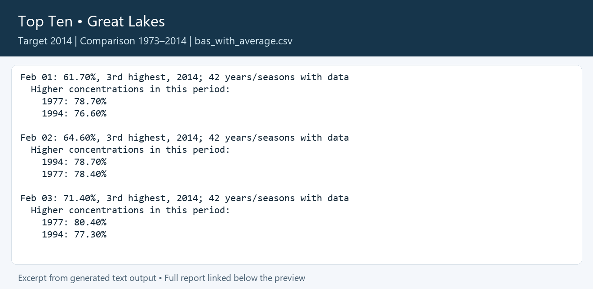
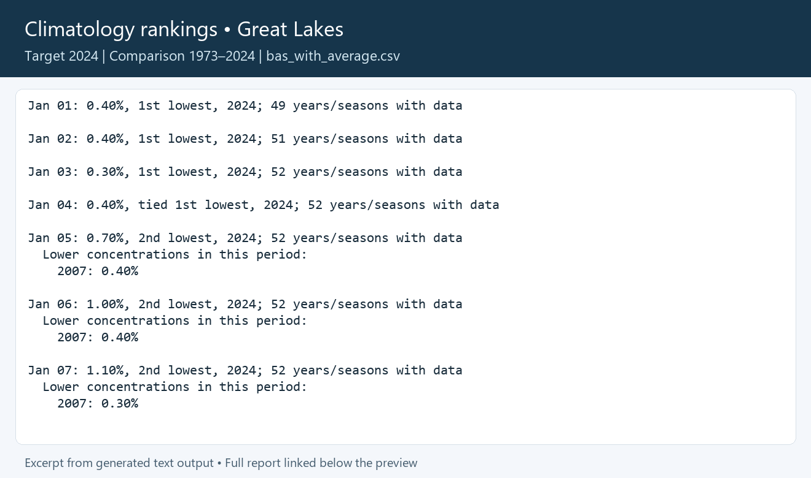
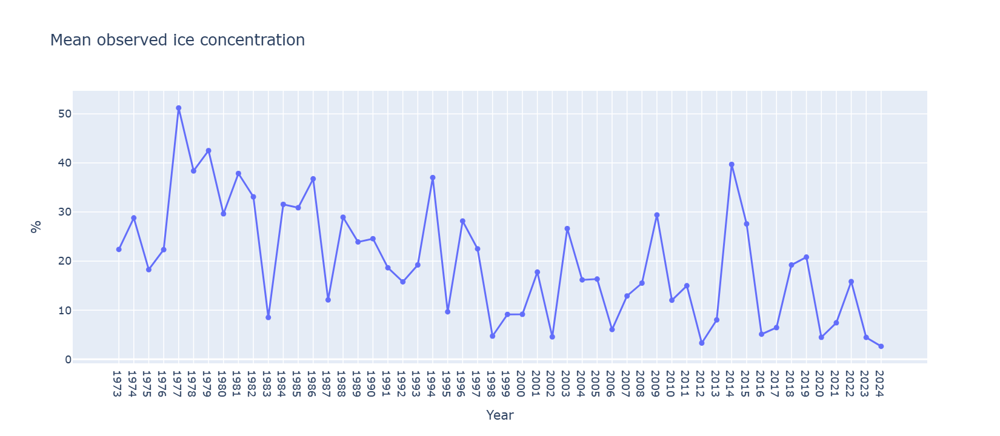
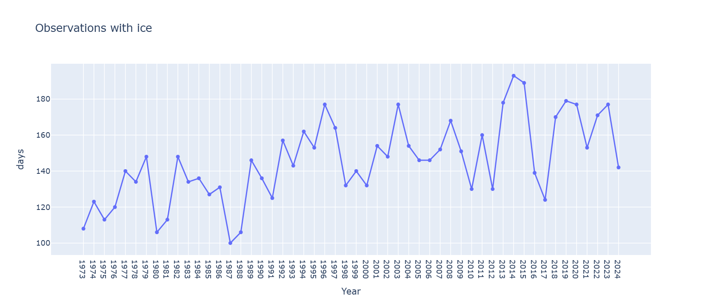
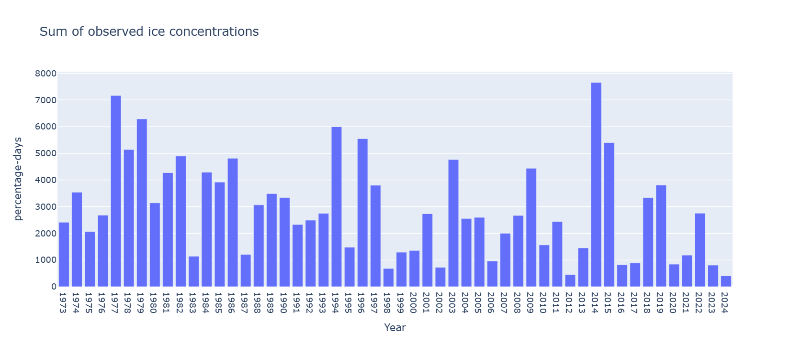
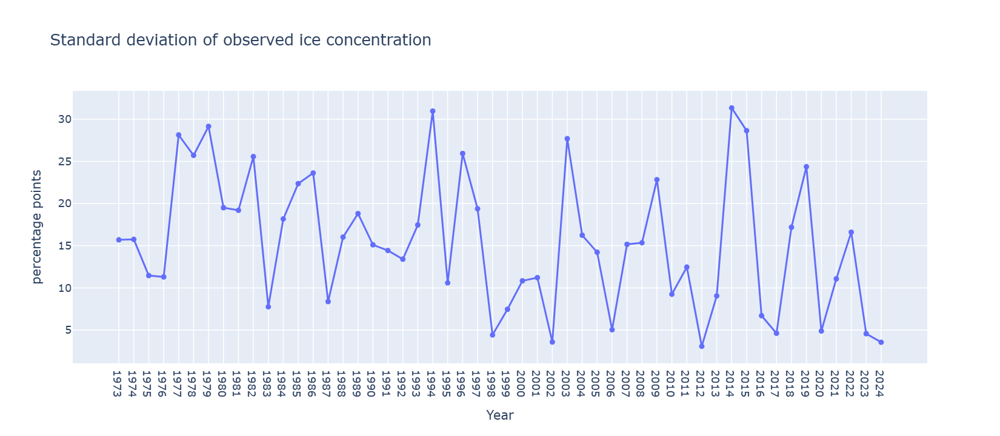
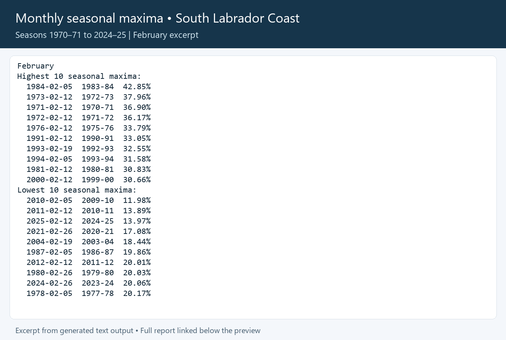

# Climatological Stats Media

Daily and weekly ice concentration rankings, seasonal maxima, and interactive HTML graphs for the Great Lakes and East Coast regions. Choose a CSV file and comparison years when you run a program.

[Sample outputs](#see-what-the-programs-produce) · [Downloads](#downloads) · [Windows quick start](#windows-quick-start) · [Python quick start](#python-quick-start)

## See what the programs produce

These examples were generated by the Python report programs using the included CSV snapshots. Click an image to see it at full size, or open the linked report to explore the complete output. The text images show excerpts; the downloadable reports include every qualifying result.

### Top Ten: high ice concentrations in 2014

How unusual was the ice on a particular date? This Great Lakes report compares **2014 with 1973–2014**, identifies dates ranking in the top ten, and lists every year with a higher concentration. On February 1, 2014, **61.70% ranked third highest**; 1977 and 1994 were higher.

[](examples/great-lakes-topten.png)

[Read the full Top Ten text report](examples/bas_with_average_topten_2014_from_1973.txt) · [Source CSV](Python/GRTLKS/bas_with_average.csv)

### Climatology: low ice and tied rankings in 2024

The climatology report also finds qualifying bottom-five results. Comparing **2024 with 1973–2024**, January 4 had **0.40%, tied for lowest**. The excerpt also shows second-lowest results and their lower comparison year. Missing observations are excluded, so the number of years with data can vary by date.

[](examples/great-lakes-climatology.png)

[Read the full climatology text report](examples/bas_with_average_climatology_2024_from_1973.txt) · [Source CSV](Python/GRTLKS/bas_with_average.csv)

### Analysis: four views of the Great Lakes record

These are static exports of the four graphs produced by the analysis program for **1973–2024**. [Open the complete interactive analysis](examples/bas_with_average_analysis_2024_from_1973.html) to hover over values, zoom, and reset the view. To use it offline, save the linked HTML file and open it in your browser; the chart library is embedded.

**Mean observed ice concentration:** compare the average of available daily observations for each year.

[](examples/great-lakes-mean.png)

**Observations with ice:** count available daily observations with concentration above zero.

[](examples/great-lakes-observations.png)

**Sum of observed ice concentrations:** compare the totals in percentage-days. These sums are not ice area measurements.

[](examples/great-lakes-sum.png)

**Sample standard deviation:** see how much the observed concentrations vary within each year, in percentage points.

[](examples/great-lakes-standard-deviation.png)

All four charts use available observations only. Missing values are not zeros, and partial years or seasons are not adjusted for missing observations. Differences in observation coverage can affect comparisons.

### Monthly seasonal maxima: South Labrador Coast

The weekly-data report lists the highest and lowest ten seasonal maxima for each month, November through May. This February excerpt uses **seasons 1970–71 through 2024–25**, with actual observation dates and concentrations converted to percent.

[](examples/south-labrador-monthly.png)

[Read the full monthly seasonal-maximum text report](examples/weekly-SLab-Coast-1970-2025_monthly_2024_from_1970.txt) · [Source CSV](Python/South%20Labrador%20Coast/weekly-SLab-Coast-1970-2025.csv)

[Example inputs and regeneration instructions](examples/README.md)

## Downloads

| Edition | Download | Programs and instructions |
| --- | --- | --- |
| Windows x64 executable | [Download CSharp.zip](https://github.com/karagang/CIS-tools/raw/refs/heads/main/Climatological_Stats_Media/CSharp.zip) | [C# folder](CSharp/) · [Instructions](CSharp/README.txt) · [Source](CSharp/Source/) |
| Python with source CSV snapshots | [Download Python.zip](https://github.com/karagang/CIS-tools/raw/refs/heads/main/Climatological_Stats_Media/Python.zip) | [Python folder and quick start](Python/) · [Detailed instructions](Python/UPDATED_PROGRAMS_README.txt) |

## Windows quick start

1. Download `CSharp.zip` and extract it to a writable folder.
2. Double-click `IceClimatology.exe`.
3. Enter the full path to your CSV, choose the start and target years, and select a report. Press Enter to accept a default year.

One executable handles every region and both CSV layouts. Python, a separate .NET installation, and internet access are not required. The HTML chart library is bundled. The executable is for Windows x64.

The C# download contains the executable, instructions, license notices, and test results. Complete C# source and rebuild scripts are available in [CSharp](CSharp/). Source CSV snapshots are supplied in the Python download and [regional folders](Python/); the executable can read those files wherever you extract them.

## Python quick start

Extract `Python.zip`, open a regional folder, and run its script. For example:

```powershell
python "Erie/Climatology-erie-usrStartDate.py"
```

Enter `erie_with_average.csv` when prompted, then select the comparison years. Text reports use the standard library. To run the HTML graph scripts, install Plotly first:

```powershell
python -m pip install -r requirements.txt
python "Erie/erie-analysis.py"
```

See the [Python guide](Python/README.md) for the regional scripts and CSV filenames.

## Report types

- **Climatology rankings:** top 10 highest and qualifying bottom 5 lowest for the selected target year or season. Lists every higher/lower year and value.
- **Top ten:** highest-only target-year rankings, with all higher years and concentrations.
- **Monthly seasonal maxima:** highest and lowest 10 seasonal maxima for each month, November through May; weekly CSV format only.
- **HTML analysis:** four offline interactive charts showing mean concentration, observations with ice, concentration sum, and sample standard deviation.

In the C# application, select a report from the menu or choose **All applicable reports**.

## Output folders

Python reports are saved in an automatically created `output` folder beside the script being run. C# reports are saved in `output` beside `IceClimatology.exe`. The CSV may be in a different folder. Each program prints its output path, preserves earlier files with numbered suffixes, and identifies the full source CSV path at the bottom of the report. Source CSVs are never modified.

## Data and comparison methods

| Regions | Frequency | CSV layout | Concentration units |
| --- | --- | --- | --- |
| Erie, Huron, Michigan, Ontario, Superior, combined Great Lakes | Daily | `Date` followed by four-digit year columns; optional `Average` | Percent, 0–100 |
| Gulf of St Lawrence, NE Newfoundland, South Labrador Coast | Weekly | `DATE`, `Season`, `Concentration`; extra columns allowed | Fraction, 0–1; converted to percent in reports |

Year columns are sorted numerically; `Average` and `Median` are excluded from rankings. Missing observations are excluded. Ties share rank: one plus the count of strictly higher/lower values. Cutoff ties are included. Bottom-five rankings require at most five zero years and at least five positive years for that period.

For weekly data, the start/target year means the **first season year**: `1995` selects season `1995–96`. Rankings compare fixed calendar bins, January 1–7, January 8–14, and so on. February 29 shares February 28's bin. Each season contributes its maximum if multiple observations fall in one bin; missing bins are excluded without interpolation. Reports describe this method and show the target observation's actual date.

The supplied Gulf CSVs contain season label `1999-20`. Both editions warn and use its starting year `1999`, displayed as `1999-00`, without changing the source file. CSVs are snapshots; replace them with updated observations as needed. Partial seasons and missing observations can affect graph comparisons.

## Verification and rebuilding

The executable was compared with the Python implementation using all 16 supplied source CSVs, every applicable report mode, and synthetic edge cases. Tests cover ties, missing values, leap days, weekly units, invalid inputs, output paths, and preservation of existing files. Daily and weekly HTML graphs were also rendered offline, checking hover, zoom, and reset. [Test results](CSharp/TEST_RESULTS.txt).

To rebuild the C# executable, install the .NET 10 SDK and run [CSharp/BUILD.ps1](CSharp/BUILD.ps1). The application is published as a self-contained, single-file Windows x64 executable. Runtime and chart redistribution notices are in [THIRD_PARTY_NOTICES.txt](CSharp/THIRD_PARTY_NOTICES.txt). [SHA-256 checksums](SHA256SUMS.txt) identify the downloads and executable.

```text
Climatological_Stats_Media/
├── Python/                 Regional scripts, CSV snapshots, and guides
├── CSharp/                 Executable, complete source, and build scripts
├── Python.zip              Python scripts and CSV snapshots
├── CSharp.zip              Ready-to-run Windows executable package
└── SHA256SUMS.txt
```
