# Great Lakes seasonal ice coverage charts

Compare a lake's latest year of ice coverage with recent, heavier, and lighter historical years, plus a calculated average. Six programs cover **Erie, Huron, Michigan, Ontario, Superior, and the combined Great Lakes**. Every run produces four charts in English and four in French.

[Back to Climatological Stats Media](../) · [Chart previews](#chart-previews) · [Downloads](#downloads) · [Windows instructions](#run-the-standalone-windows-edition) · [Python instructions](#run-the-python-edition)

This is a separate tool set from the [ranking, top-ten, monthly maxima, and HTML analysis reports](../). These programs produce PNG seasonal comparison charts.

## Downloads

| Edition | Complete download | Source and documentation |
| --- | --- | --- |
| Standalone Windows x64 | [C# programs, six executables, CSV data, and output examples — ZIP](https://github.com/karagang/CIS-tools/releases/download/great-lakes-seasonal-ice-charts-v1.0.0/Great_Lakes_Climatology_Charts_CSharp_Windows_x64.zip) | [C# source and build guide](CSharp/) |
| Python | [Six Python programs, CSV data, and output examples — ZIP](https://github.com/karagang/CIS-tools/releases/download/great-lakes-seasonal-ice-charts-v1.0.0/Great_Lakes_Climatology_Charts_Python.zip) | [Python source and usage guide](Python/) |

[Release notes and download checksums](https://github.com/karagang/CIS-tools/releases/tag/great-lakes-seasonal-ice-charts-v1.0.0). The Windows ZIP is approximately 213 MiB because it includes a runtime in each of the six independent applications. Python users install the dependencies listed below. CSVs are supplied snapshots; charts are not updated automatically.

## Chart previews

These examples use the supplied **1973–2026** data, with **2026 as the current year** and **1973 as the selected start year**. Click a thumbnail for the full PNG. Both editions use the same data and calculations; native C# rendering differs slightly from Matplotlib in fonts, colors, and spacing.

### Combined chart: three seasonal comparisons in one image

<table>
<thead><tr><th>Python — English</th><th>C# — English</th></tr></thead>
<tbody><tr>
<td><a href="Python/combined_GRTLKS/output/Great_LakesIce_2026_Combined_EN.png">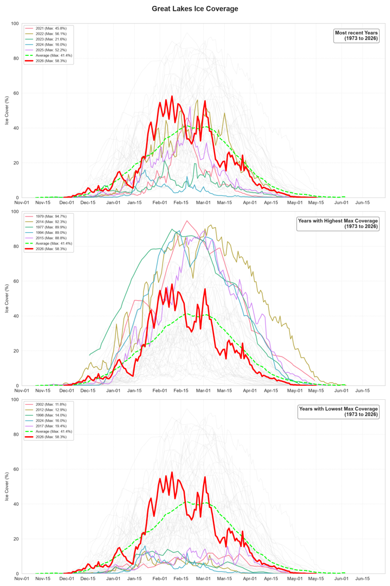</a></td>
<td><a href="CSharp/combined_GRTLKS/output/Great_LakesIce_2026_Combined_EN.png">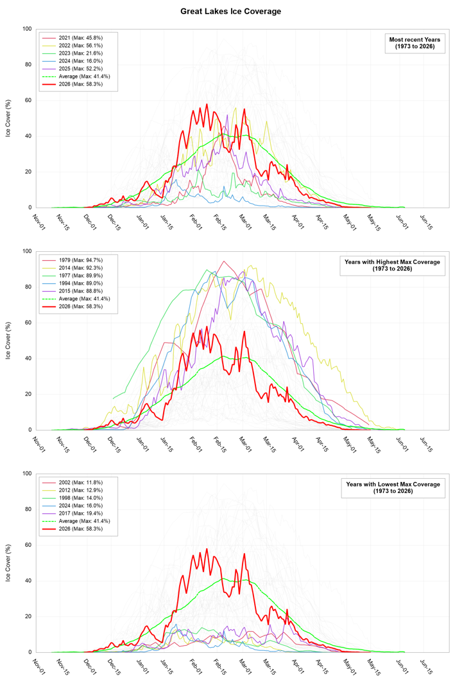</a></td>
</tr></tbody>
</table>

### Individual charts, including French examples

<table>
<thead><tr><th>Chart</th><th>Python</th><th>C#</th></tr></thead>
<tbody>
<tr><td>Recent years — English</td><td><a href="Python/combined_GRTLKS/output/Great_LakesIce_2026_Recent_EN.png">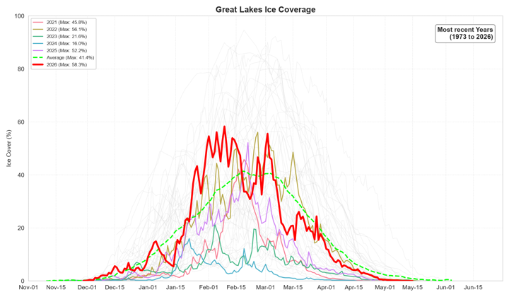</a></td><td><a href="CSharp/combined_GRTLKS/output/Great_LakesIce_2026_Recent_EN.png">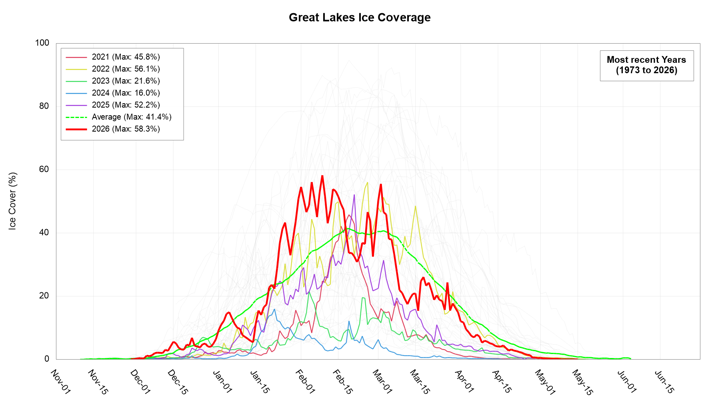</a></td></tr>
<tr><td>Heavier years — French</td><td><a href="Python/combined_GRTLKS/output/Great_LakesIce_2026_Heavier_FR.png">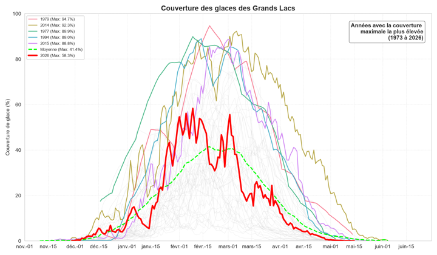</a></td><td><a href="CSharp/combined_GRTLKS/output/Great_LakesIce_2026_Heavier_FR.png">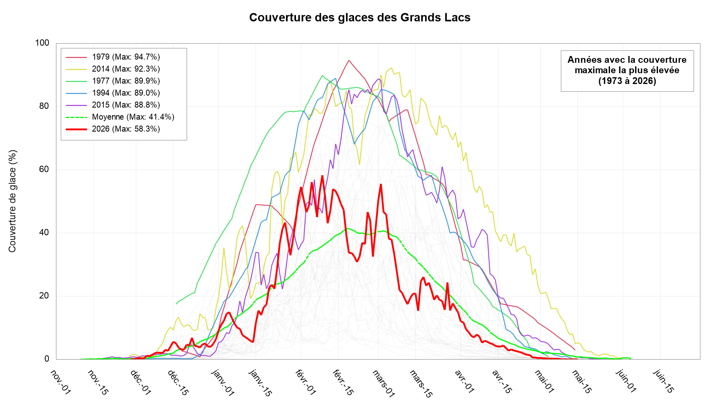</a></td></tr>
<tr><td>Lighter years — French</td><td><a href="Python/combined_GRTLKS/output/Great_LakesIce_2026_Lighter_FR.png">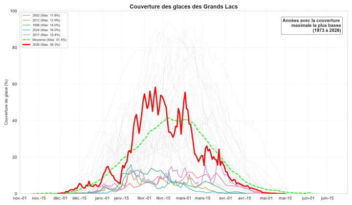</a></td><td><a href="CSharp/combined_GRTLKS/output/Great_LakesIce_2026_Lighter_FR.png">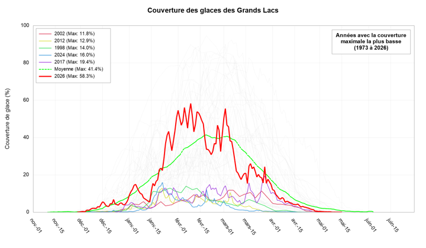</a></td></tr>
</tbody>
</table>

### All six lake areas

Each thumbnail links to a full C# recent-years example. The corresponding [Python output folders](Python/) also contain all eight bilingual charts for each lake.

<table>
<thead><tr><th>Erie</th><th>Huron</th><th>Michigan</th></tr></thead>
<tbody><tr>
<td><a href="CSharp/Erie/output/Erie_2026_Recent_EN.png">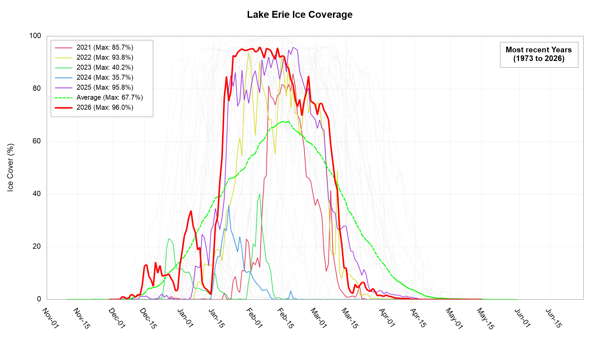</a></td>
<td><a href="CSharp/Huron/output/Huron_2026_Recent_EN.png">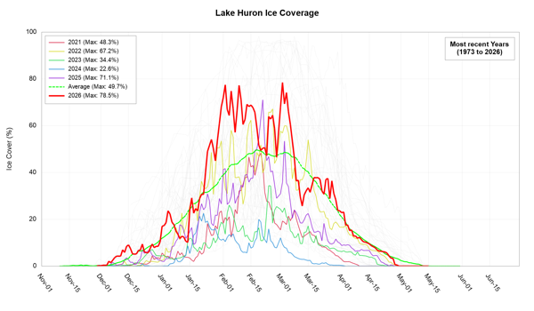</a></td>
<td><a href="CSharp/Michigan/output/Michigan_2026_Recent_EN.png">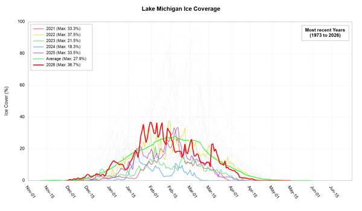</a></td>
</tr></tbody>
<thead><tr><th>Ontario</th><th>Superior</th><th>Combined Great Lakes</th></tr></thead>
<tbody><tr>
<td><a href="CSharp/Ontario/output/Ontario_2026_Recent_EN.png">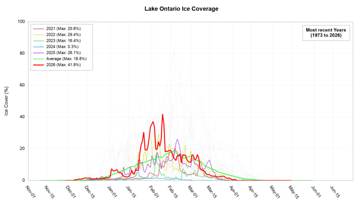</a></td>
<td><a href="CSharp/Superior/output/Superior_2026_Recent_EN.png">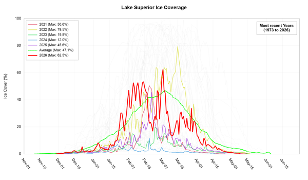</a></td>
<td><a href="CSharp/combined_GRTLKS/output/Great_LakesIce_2026_Recent_EN.png">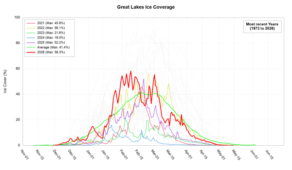</a></td>
</tr></tbody>
</table>

## Run the standalone Windows edition

1. Download the **complete Windows ZIP** above and extract it into a writable folder.
2. Open one of the six lake folders inside `Great_Lakes_Climatology_Charts_CSharp`.
3. Double-click that folder's `*_IceCharts.exe`.
4. Press Enter to use the included CSV, or enter a different CSV path.
5. Enter the start year for the historical comparison, or press Enter for the earliest year available.
6. Open the lake's `output` folder for the eight PNG files.

**No Python, VS Code, Visual Studio, separate .NET installation, or internet connection is needed to run the downloaded executable.** These are Windows x64 applications. Each lake folder can be distributed separately with its executable, CSV, output folder, and license notices.

For a run without prompts, open PowerShell in a lake folder:

```powershell
.\Erie_IceCharts.exe --defaults
.\Erie_IceCharts.exe --defaults --start-year 2000
.\Erie_IceCharts.exe --defaults --csv "C:\Data\erie.csv" --output "C:\Charts\Erie"
```

The default CSV and output locations are relative to the executable, even when it is launched from another folder. See the [C# guide](CSharp/README.md) for rebuilding, additional options, and calculation checks. The repository's C# folder contains source and examples; ready-to-run executables are supplied in the release download.

## Run the Python edition

Install Python 3.11 or newer, download and extract the **Python ZIP**, then open a terminal in `Great_Lakes_Climatology_Charts_Python`:

```powershell
python -m pip install -r requirements.txt
python "Erie/overlay-seasonEnd-Erie-bilang.py"
```

Press Enter to select the included CSV, then choose the start year. The script writes the eight charts into `Erie/output`, regardless of the terminal's working directory. Substitute another lake's script using the table below. You can also open a script in VS Code and select **Run Python File**.

The dependencies are pandas, Matplotlib, and seaborn. See the [Python guide](Python/README.md) for the CSV format, all script names, and troubleshooting.

## Programs and default CSV files

| Area / folder | Python script | Windows executable | Default CSV |
| --- | --- | --- | --- |
| `combined_GRTLKS` | `overlay-seasonEnd-GRTLKS-bilang.py` | `combined_GRTLKS_IceCharts.exe` | `bas_with_average.csv` |
| `Erie` | `overlay-seasonEnd-Erie-bilang.py` | `Erie_IceCharts.exe` | `erie_with_average.csv` |
| `Huron` | `overlay-seasonEnd-Huron-bilang.py` | `Huron_IceCharts.exe` | `huron_with_average.csv` |
| `Michigan` | `overlay-seasonEnd-Mich-bilang.py` | `Michigan_IceCharts.exe` | `michigan_with_average.csv` |
| `Ontario` | `overlay-seasonEnd-Ontario-bilang.py` | `Ontario_IceCharts.exe` | `ontario_with_average.csv` |
| `Superior` | `overlay-seasonEnd-Superior-bilang.py` | `Superior_IceCharts.exe` | `superior_with_average.csv` |

## How to interpret the charts

- **Current year:** the latest numeric year column in the CSV, shown in red. It is not selected from the computer's calendar date.
- **Average / Moyenne:** the daily mean of available observations from the selected start year through the year before the current year, shown as a dashed green curve. Missing observations are skipped; the CSV's pre-existing `Average` column is ignored.
- **Recent:** the last five historical years within the selected range.
- **Heavier:** up to five years with annual maxima strictly above the current year's maximum, highest first.
- **Lighter:** up to five years with annual maxima strictly below the current year's maximum, lowest first. If none are lower, the five lowest historical maxima are used instead.
- **Background:** other historical years within the selected range, drawn in light grey.

The date axis runs from November 1 to June 30, aligned to a common leap-year season. The vertical axis is ice coverage in percent, fixed at 0–100. Each legend lists the maximum for its curve. Missing data break the lines; partial seasons and varying observation coverage can affect comparisons.

## Output files

For Erie with latest CSV year 2026, the filenames are:

```text
Erie_2026_Combined_EN.png     Erie_2026_Combined_FR.png
Erie_2026_Recent_EN.png       Erie_2026_Recent_FR.png
Erie_2026_Heavier_EN.png      Erie_2026_Heavier_FR.png
Erie_2026_Lighter_EN.png      Erie_2026_Lighter_FR.png
```

The combined image has three stacked panels, 1800 × 2700 pixels. Individual images are 1800 × 1050 pixels. All are saved at 150 DPI. **Running the same lake and latest year again replaces files with matching names**, including when you change the start year. Copy or rename earlier charts first if you want to keep multiple comparison ranges.

## Verification and source layout

All six C# programs were compared with Python at start years 1973 and 2000. Checks cover each selected category, every annual maximum, every daily average, PNG filenames, dimensions, language sets, and DPI. Each standalone application was also tested after relocation with only its executable and CSV. [Verification details and hashes](CSharp/VERIFICATION.json) · [Source-level CSV and calculation checks](CSharp/Tests/Program.cs).

```text
Seasonal_Ice_Charts/
├── README.md
├── Python/                 Six lake folders: scripts, CSVs, output examples
│   ├── README.md
│   └── requirements.txt
├── CSharp/                 Six lake folders: C# projects, CSVs, output examples
│   ├── Shared/             Native C# calculations and chart rendering
│   ├── Tests/
│   ├── Build.ps1
│   └── README.md
└── examples/               Thumbnail images linked to full-size PNGs
```

Complete downloadable packages preserve the independent Python and C# folder structures. Their data copies are separate; updating one edition's CSV does not update the other.
