# Overlay Charts catalogue

Great Lakes and East Coast programs, source code, instructions, PNG plots, and complete downloads. This catalogue works directly on GitHub and does not depend on the retired website.

[Project instructions](../README.md) · [All PNG plots](assets/charts/) · [All downloads](downloads/)

## Program catalogue

### Gulf of St. Lawrence — Choose a period (C#)

Latest-season and recent-season ice overlays. Choose a starting season and cutoff date.

[Source code](../Gulf/gulf-Overlay-both.cs) · [Instructions](programs/gulf-overlay-both.md) · [Full-size PNG](assets/charts/gulf-Overlay-both-single.png) · [Download ZIP](https://github.com/karagang/CIS-tools/raw/refs/heads/main/Overlay%20Charts/docs/downloads/east-coast-csharp.zip)

[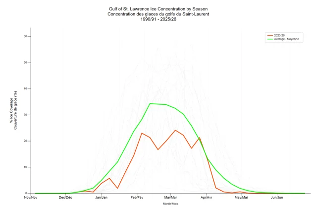](assets/charts/gulf-Overlay-both-single.png)

### Gulf of St. Lawrence — From 1990/91 (C#)

Latest-season and recent-season ice overlays. No prompts: 1990/91 onward.

[Source code](../Gulf/gulf-Overlay-from1990.cs) · [Instructions](programs/gulf-overlay-from1990.md) · [Full-size PNG](assets/charts/gulf-Overlay-from1990-single.png) · [Download ZIP](https://github.com/karagang/CIS-tools/raw/refs/heads/main/Overlay%20Charts/docs/downloads/east-coast-csharp.zip)

### NE Newfoundland — Choose a period (C#)

Latest-season and recent-season ice overlays. Choose a starting season and cutoff date.

[Source code](../NewFoundLand/NFLND-Overlay-both.cs) · [Instructions](programs/nflnd-overlay-both.md) · [Full-size PNG](assets/charts/NFLND-Overlay-both-single.png) · [Download ZIP](https://github.com/karagang/CIS-tools/raw/refs/heads/main/Overlay%20Charts/docs/downloads/east-coast-csharp.zip)

### NE Newfoundland — From 1990/91 (C#)

Latest-season and recent-season ice overlays. No prompts: 1990/91 onward.

[Source code](../NewFoundLand/NFLND-Overlay-from1990.cs) · [Instructions](programs/nflnd-overlay-from1990.md) · [Full-size PNG](assets/charts/NFLND-Overlay-from1990-single.png) · [Download ZIP](https://github.com/karagang/CIS-tools/raw/refs/heads/main/Overlay%20Charts/docs/downloads/east-coast-csharp.zip)

[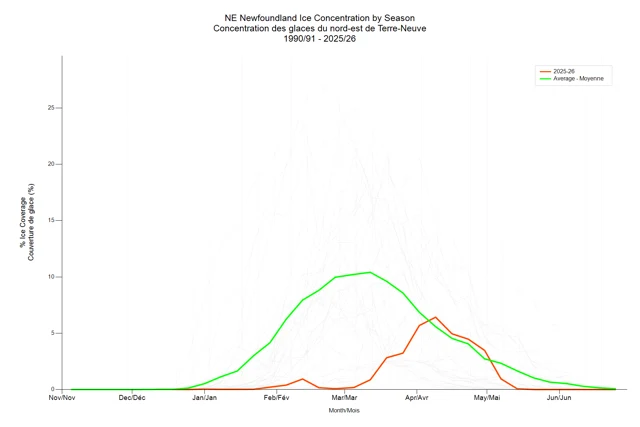](assets/charts/NFLND-Overlay-from1990-single.png)

### South Labrador Coast — Choose a period (C#)

Latest-season and recent-season ice overlays. Choose a starting season and cutoff date.

[Source code](../SouthLabCoast/SLabCoast-Overlay-both.cs) · [Instructions](programs/slabcoast-overlay-both.md) · [Full-size PNG](assets/charts/SLabCoast-Overlay-both-single.png) · [Download ZIP](https://github.com/karagang/CIS-tools/raw/refs/heads/main/Overlay%20Charts/docs/downloads/east-coast-csharp.zip)

[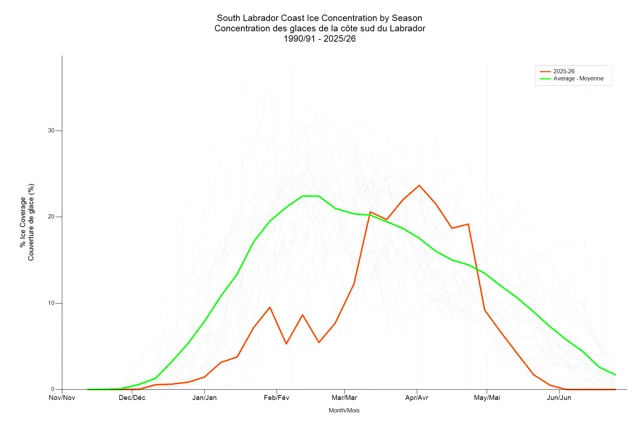](assets/charts/SLabCoast-Overlay-both-single.png)

### South Labrador Coast — From 1990/91 (C#)

Latest-season and recent-season ice overlays. No prompts: 1990/91 onward.

[Source code](../SouthLabCoast/SLabCoast-Overlay-from1990.cs) · [Instructions](programs/slabcoast-overlay-from1990.md) · [Full-size PNG](assets/charts/SLabCoast-Overlay-from1990-single.png) · [Download ZIP](https://github.com/karagang/CIS-tools/raw/refs/heads/main/Overlay%20Charts/docs/downloads/east-coast-csharp.zip)

### Gulf of St. Lawrence — choose a period (Python)

Generate the latest-season and recent-season overlay charts with pandas and Matplotlib.

[Source code](../Gulf/gulf-Overlay-both.py) · [Instructions](programs/gulf-overlay-both-python.md) · [Full-size PNG](assets/charts/gulf-Overlay-both-python-single.png) · [Download ZIP](https://github.com/karagang/CIS-tools/raw/refs/heads/main/Overlay%20Charts/docs/downloads/east-coast-python.zip)

[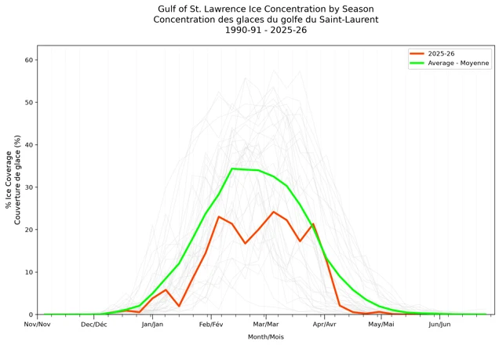](assets/charts/gulf-Overlay-both-python-single.png)

### Gulf of St. Lawrence — from 1990/91 (Python)

Generate the latest-season and recent-season overlay charts with pandas and Matplotlib.

[Source code](../Gulf/gulf-Overlay-from1990.py) · [Instructions](programs/gulf-overlay-from1990-python.md) · [Full-size PNG](assets/charts/gulf-Overlay-from1990-python-single.png) · [Download ZIP](https://github.com/karagang/CIS-tools/raw/refs/heads/main/Overlay%20Charts/docs/downloads/east-coast-python.zip)

### NE Newfoundland — choose a period (Python)

Generate the latest-season and recent-season overlay charts with pandas and Matplotlib.

[Source code](../NewFoundLand/NFLND-Overlay-both.py) · [Instructions](programs/nflnd-overlay-both-python.md) · [Full-size PNG](assets/charts/NFLND-Overlay-both-python-single.png) · [Download ZIP](https://github.com/karagang/CIS-tools/raw/refs/heads/main/Overlay%20Charts/docs/downloads/east-coast-python.zip)

### NE Newfoundland — from 1990/91 (Python)

Generate the latest-season and recent-season overlay charts with pandas and Matplotlib.

[Source code](../NewFoundLand/NFLND-Overlay-from1990.py) · [Instructions](programs/nflnd-overlay-from1990-python.md) · [Full-size PNG](assets/charts/NFLND-Overlay-from1990-python-single.png) · [Download ZIP](https://github.com/karagang/CIS-tools/raw/refs/heads/main/Overlay%20Charts/docs/downloads/east-coast-python.zip)

[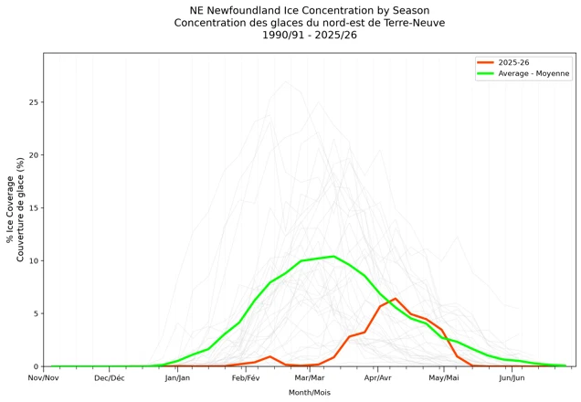](assets/charts/NFLND-Overlay-from1990-python-single.png)

### South Labrador Coast — choose a period (Python)

Generate the latest-season and recent-season overlay charts with pandas and Matplotlib.

[Source code](../SouthLabCoast/SLabCoast-Overlay-both.py) · [Instructions](programs/slabcoast-overlay-both-python.md) · [Full-size PNG](assets/charts/SLabCoast-Overlay-both-python-single.png) · [Download ZIP](https://github.com/karagang/CIS-tools/raw/refs/heads/main/Overlay%20Charts/docs/downloads/east-coast-python.zip)

[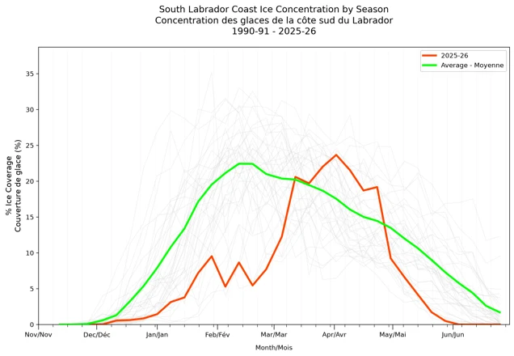](assets/charts/SLabCoast-Overlay-both-python-single.png)

### South Labrador Coast — from 1990/91 (Python)

Generate the latest-season and recent-season overlay charts with pandas and Matplotlib.

[Source code](../SouthLabCoast/SLabCoast-Overlay-from1990.py) · [Instructions](programs/slabcoast-overlay-from1990-python.md) · [Full-size PNG](assets/charts/SLabCoast-Overlay-from1990-python-single.png) · [Download ZIP](https://github.com/karagang/CIS-tools/raw/refs/heads/main/Overlay%20Charts/docs/downloads/east-coast-python.zip)

### Lake Erie overlays (C#)

Create bilingual, English, and French overlays showing recent ice seasons against the historical background and supplied average.

[Source code](../OtherCSharpSources/Erie-OverlayCharts.cs) · [Instructions](programs/great-lakes-overlay-erie.md) · [Full-size PNG](assets/charts/great-lakes-overlay-erie.png) · [Download ZIP](https://github.com/karagang/CIS-tools/raw/refs/heads/main/Overlay%20Charts/docs/downloads/great-lakes-overlays-csharp.zip)

[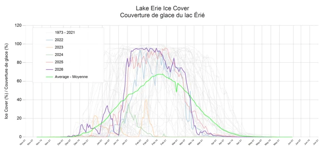](assets/charts/great-lakes-overlay-erie.png)

### Lake Ontario overlays (C#)

Create bilingual, English, and French overlays showing recent ice seasons against the historical background and supplied average.

[Source code](../OtherCSharpSources/Ontario-OverlayCharts.cs) · [Instructions](programs/great-lakes-overlay-ontario.md) · [Full-size PNG](assets/charts/great-lakes-overlay-ontario.png) · [Download ZIP](https://github.com/karagang/CIS-tools/raw/refs/heads/main/Overlay%20Charts/docs/downloads/great-lakes-overlays-csharp.zip)

[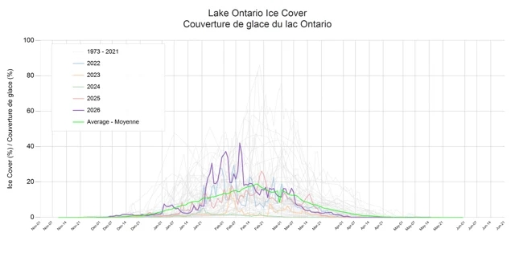](assets/charts/great-lakes-overlay-ontario.png)

### Lake Superior overlays (C#)

Create bilingual, English, and French overlays showing recent ice seasons against the historical background and supplied average.

[Source code](../OtherCSharpSources/Superior-OverlayCharts.cs) · [Instructions](programs/great-lakes-overlay-superior.md) · [Full-size PNG](assets/charts/great-lakes-overlay-superior.png) · [Download ZIP](https://github.com/karagang/CIS-tools/raw/refs/heads/main/Overlay%20Charts/docs/downloads/great-lakes-overlays-csharp.zip)

[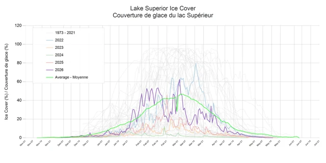](assets/charts/great-lakes-overlay-superior.png)

### Lake Huron overlays (C#)

Create bilingual, English, and French overlays showing recent ice seasons against the historical background and supplied average.

[Source code](../OtherCSharpSources/Huron-OverlayCharts.cs) · [Instructions](programs/great-lakes-overlay-huron.md) · [Full-size PNG](assets/charts/great-lakes-overlay-huron.png) · [Download ZIP](https://github.com/karagang/CIS-tools/raw/refs/heads/main/Overlay%20Charts/docs/downloads/great-lakes-overlays-csharp.zip)

[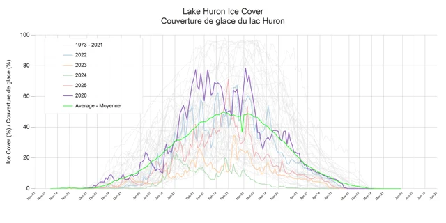](assets/charts/great-lakes-overlay-huron.png)

### Lake Michigan overlays (C#)

Create bilingual, English, and French overlays showing recent ice seasons against the historical background and supplied average.

[Source code](../OtherCSharpSources/Michigan-OverlayCharts.cs) · [Instructions](programs/great-lakes-overlay-michigan.md) · [Full-size PNG](assets/charts/great-lakes-overlay-michigan.png) · [Download ZIP](https://github.com/karagang/CIS-tools/raw/refs/heads/main/Overlay%20Charts/docs/downloads/great-lakes-overlays-csharp.zip)

[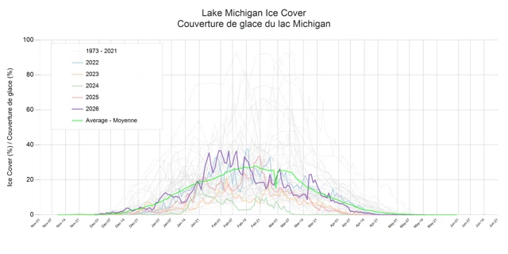](assets/charts/great-lakes-overlay-michigan.png)

### Combined Great Lakes overlays (C#)

Create bilingual, English, and French overlays showing recent ice seasons against the historical background and supplied average.

[Source code](../OtherCSharpSources/Great_Lakes-OverlayCharts.cs) · [Instructions](programs/great-lakes-overlay-great_lakes.md) · [Full-size PNG](assets/charts/great-lakes-overlay-great_lakes.png) · [Download ZIP](https://github.com/karagang/CIS-tools/raw/refs/heads/main/Overlay%20Charts/docs/downloads/great-lakes-overlays-csharp.zip)

[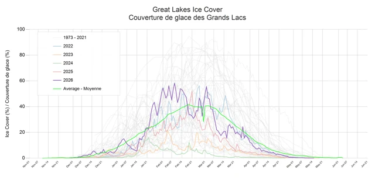](assets/charts/great-lakes-overlay-great_lakes.png)

### Great Lakes overlays — all six regions (Python)

Generate English, French, and bilingual charts for Erie, Huron, Michigan, Ontario, Superior, and the combined basin: eighteen PNGs in one run.

[Source code](../PythonSources/generate_all_lake_charts.py) · [Instructions](programs/great-lakes-overlays-python.md) · [Full-size PNG](assets/charts/great-lakes-overlay-superior.png) · [Download ZIP](https://github.com/karagang/CIS-tools/raw/refs/heads/main/Overlay%20Charts/docs/downloads/great-lakes-overlays-python.zip)

### Great Lakes — twelve-chart batch (C#)

Create single-season and two-season comparisons for all five Great Lakes and the combined basin.

[Source code](../OtherCSharpSources/GreatLakesCharts.cs) · [Instructions](programs/great-lakes-batch-csharp.md) · [Full-size PNG](assets/charts/great-lakes-batch-csharp.png) · [Download ZIP](https://github.com/karagang/CIS-tools/raw/refs/heads/main/Overlay%20Charts/docs/downloads/great-lakes-batch-csharp.zip)

[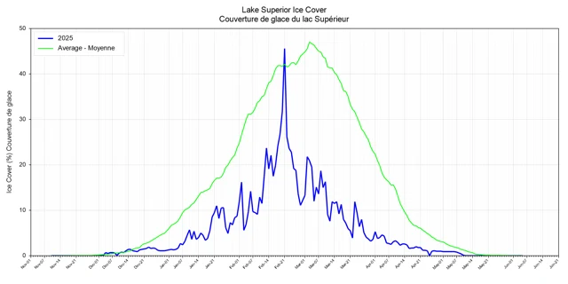](assets/charts/great-lakes-batch-csharp.png)

### Great Lakes — twelve-chart batch (Python)

Create single-season and two-season comparisons for all five Great Lakes and the combined basin.

[Source code](../PythonSources/great_lakes_charts.py) · [Instructions](programs/great-lakes-batch-python.md) · [Full-size PNG](assets/charts/great-lakes-batch-python.png) · [Download ZIP](https://github.com/karagang/CIS-tools/raw/refs/heads/main/Overlay%20Charts/docs/downloads/great-lakes-batch-python.zip)

[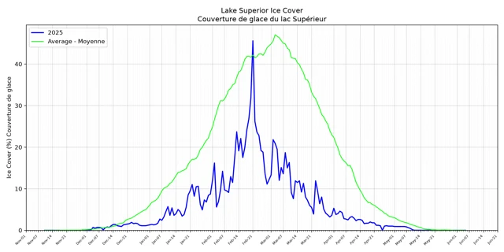](assets/charts/great-lakes-batch-python.png)

### Combined Great Lakes — original three-chart generator (C#)

The earlier combined-basin generator, retained alongside the later six-lake editions. Produces bilingual, English, and French overlay plots.

[Source code](../OtherCSharpSources/CombinedGreatLakesLegacy.cs) · [Instructions](programs/combined-great-lakes-legacy-csharp.md) · [Full-size PNG](assets/charts/great-lakes-overlay-great_lakes.png) · [Download ZIP](https://github.com/karagang/CIS-tools/raw/refs/heads/main/Overlay%20Charts/docs/downloads/combined-great-lakes-legacy-csharp.zip)

### Combined Great Lakes — original three-chart generator (Python)

The earlier combined-basin generator, retained alongside the later six-lake editions. Produces bilingual, English, and French overlay plots.

[Source code](../PythonSources/Overlay_chart-GRTLKS-bilingual-3charts.py) · [Instructions](programs/combined-great-lakes-legacy-python.md) · [Full-size PNG](assets/charts/great-lakes-overlay-great_lakes.png) · [Download ZIP](https://github.com/karagang/CIS-tools/raw/refs/heads/main/Overlay%20Charts/docs/downloads/combined-great-lakes-python.zip)

