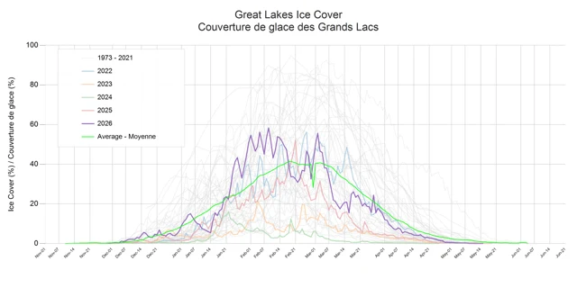

[← All programs](../README.md#program-catalogue)

C# / Ice coverage charts

# Combined Great Lakes — original three-chart generator

The earlier combined-basin generator, retained alongside the later six-lake editions. Produces bilingual, English, and French overlay plots.

[Download complete package (.zip)](https://github.com/karagang/CIS-tools/raw/refs/heads/main/Overlay%20Charts/docs/downloads/combined-great-lakes-legacy-csharp.zip) · [View C# source](https://github.com/karagang/CIS-tools/blob/main/Overlay%20Charts/OtherCSharpSources/CombinedGreatLakesLegacy.cs)

[Open the Python version guide →](combined-great-lakes-legacy-python.md)

## Example plot

[](../assets/charts/great-lakes-overlay-great_lakes.png)

A plot generated with the included data. Select it to view the full-size PNG. The preview is a snapshot, not a live data feed.

## Run the program

Extract the full ZIP before running. Keep its folder structure and the included CSV files together.

```powershell
.\OverlayCharts.exe
```

Use the included `bas_with_average.csv` when prompted. Options include `--output-dir`, `--last-n`, and `--no-show`. PNGs are saved beside the CSV unless an output folder is supplied. This is the original generic version; the later lake-specific C# editions have lake-named executables.

Rerunning replaces output images with matching filenames. Update the CSV copies when new data is available. The webpages document local programs; the programs do not run in your browser.

[← All programs, source, and chart previews](../README.md)
