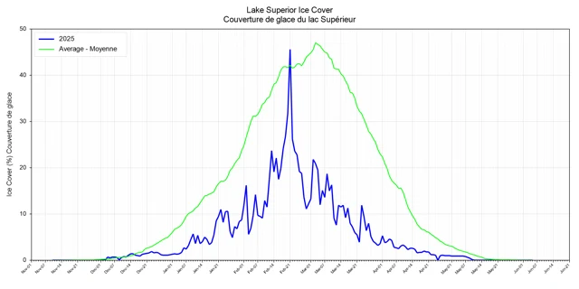

[← All programs](../README.md#program-catalogue)

C# / Ice coverage charts

# Great Lakes — twelve-chart batch

Create single-season and two-season comparisons for all five Great Lakes and the combined basin.

[Download complete package (.zip)](https://github.com/karagang/CIS-tools/raw/refs/heads/main/Overlay%20Charts/docs/downloads/great-lakes-batch-csharp.zip) · [View C# source](https://github.com/karagang/CIS-tools/blob/main/Overlay%20Charts/OtherCSharpSources/GreatLakesCharts.cs)

[Open the Python version guide →](great-lakes-batch-python.md)

## Example plot

[](../assets/charts/great-lakes-batch-csharp.png)

A plot generated with the included data. Select it to view the full-size PNG. The preview is a snapshot, not a live data feed.

## Run the program

Extract the full ZIP before running. Keep its folder structure and the included CSV files together.

```powershell
.\GreatLakesCharts.exe
```

Reads six CSV files from the included `Data` folder. For each lake, selects the latest populated year and creates a single-season plot and a comparison with the preceding calendar year. The supplied average is included. All twelve images are saved in lake-specific folders under `output`.

Options: `--data-dir`, `--output-dir`, and `--year`. Defaults are relative to the program location.

Windows .NET Framework application. No Python is required. Use `--quiet` to suppress the completion dialog; status is available through redirected console output. Source and rebuild script are included.

Rerunning replaces output images with matching filenames. Update the CSV copies when new data is available. The webpages document local programs; the programs do not run in your browser.

[← All programs, source, and chart previews](../README.md)
