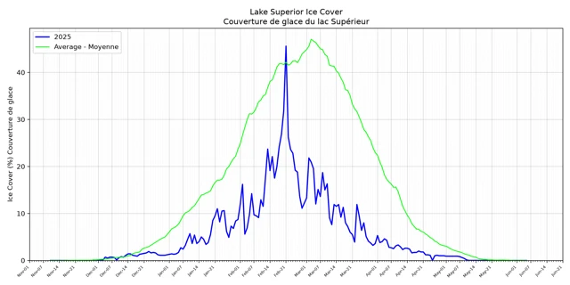

[← All programs](../README.md#program-catalogue)

Python / Ice coverage charts

# Great Lakes — twelve-chart batch

Create single-season and two-season comparisons for all five Great Lakes and the combined basin.

[Download complete package (.zip)](https://github.com/karagang/CIS-tools/raw/refs/heads/main/Overlay%20Charts/docs/downloads/great-lakes-batch-python.zip) · [View Python source](https://github.com/karagang/CIS-tools/blob/main/Overlay%20Charts/PythonSources/great_lakes_charts.py)

[Open the C# version guide →](great-lakes-batch-csharp.md)

## Example plot

[](../assets/charts/great-lakes-batch-python.png)

A plot generated with the included data. Select it to view the full-size PNG. The preview is a snapshot, not a live data feed.

## Run the program

Extract the full ZIP before running. Keep its folder structure and the included CSV files together.

```powershell
python -m pip install -r requirements.txt
python great_lakes_charts.py
```

Reads six CSV files from the included `Data` folder. For each lake, selects the latest populated year and creates a single-season plot and a comparison with the preceding calendar year. The supplied average is included. All twelve images are saved in lake-specific folders under `output`.

Options: `--data-dir`, `--output-dir`, and `--year`. Defaults are relative to the program location.

Requires Python 3.9 or newer with the packages in `requirements.txt`. It runs without prompts or plot windows.

Rerunning replaces output images with matching filenames. Update the CSV copies when new data is available. The webpages document local programs; the programs do not run in your browser.

[← All programs, source, and chart previews](../README.md)
