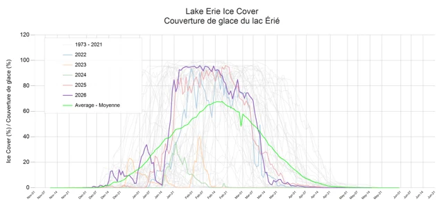

[← All programs](../README.md#program-catalogue)

C# / Ice coverage charts

# Lake Erie overlays

Create bilingual, English, and French overlays showing recent ice seasons against the historical background and supplied average.

[Download complete package (.zip)](https://github.com/karagang/CIS-tools/raw/refs/heads/main/Overlay%20Charts/docs/downloads/great-lakes-overlays-csharp.zip) · [View C# source](https://github.com/karagang/CIS-tools/blob/main/Overlay%20Charts/OtherCSharpSources/Erie-OverlayCharts.cs)

[Open the Python version guide →](great-lakes-overlays-python.md)

## Example plot

[](../assets/charts/great-lakes-overlay-erie.png)

A plot generated with the included data. Select it to view the full-size PNG. The preview is a snapshot, not a live data feed.

## Run the program

Extract the full ZIP before running. Keep its folder structure and the included CSV files together.

```powershell
.\Erie\Erie_OverlayCharts.exe
```

Press Enter to use the regional CSV beside the executable. Three 300-DPI PNGs are saved beside the CSV and opened with the default image viewer.

Options include a CSV path, `--output-dir FOLDER`, `--last-n 5`, and `--no-show`. Requires Windows and .NET Framework; no Python or NuGet packages are needed. Source and per-lake build scripts are in the ZIP.

The Python companion generates all eighteen charts across these six regions in one run.

Rerunning replaces output images with matching filenames. Update the CSV copies when new data is available. The webpages document local programs; the programs do not run in your browser.

[← All programs, source, and chart previews](../README.md)
