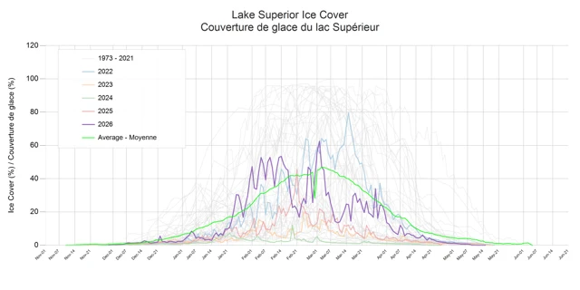

[← All programs](../README.md#program-catalogue)

Python / Ice coverage charts

# Great Lakes overlays — all six regions

Generate English, French, and bilingual charts for Erie, Huron, Michigan, Ontario, Superior, and the combined basin: eighteen PNGs in one run.

[Download complete package (.zip)](https://github.com/karagang/CIS-tools/raw/refs/heads/main/Overlay%20Charts/docs/downloads/great-lakes-overlays-python.zip) · [View Python source](https://github.com/karagang/CIS-tools/blob/main/Overlay%20Charts/PythonSources/generate_all_lake_charts.py)

[Open the C# version guide →](great-lakes-overlay-superior.md)

## Example plot

[](../assets/charts/great-lakes-overlay-superior.png)

A plot generated with the included data. Select it to view the full-size PNG. The preview is a snapshot, not a live data feed.

## Run the program

Extract the full ZIP before running. Keep its folder structure and the included CSV files together.

```powershell
python -m pip install -r requirements.txt
python generate_all_lake_charts.py
```

The included CSV folders match the script’s relative paths. Charts are written beside each regional CSV, and all figures are displayed after generation.

The `--check` option checks that the six CSV paths exist without generating charts. Requires pandas, NumPy, Matplotlib, and seaborn. The original program is preserved.

Rerunning replaces output images with matching filenames. Update the CSV copies when new data is available. The webpages document local programs; the programs do not run in your browser.

[← All programs, source, and chart previews](../README.md)
