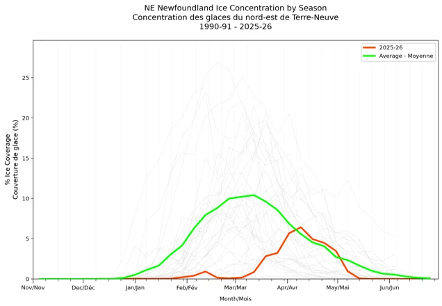

[← All programs](../README.md#program-catalogue)

Python / Ice coverage charts

# NE Newfoundland — choose a period

Generate the latest-season and recent-season overlay charts with pandas and Matplotlib.

[Download complete package (.zip)](https://github.com/karagang/CIS-tools/raw/refs/heads/main/Overlay%20Charts/docs/downloads/east-coast-python.zip) · [View Python source](https://github.com/karagang/CIS-tools/blob/main/Overlay%20Charts/NewFoundLand/NFLND-Overlay-both.py)

[Open the C# version guide →](nflnd-overlay-both.md)

## Example plot

[](../assets/charts/NFLND-Overlay-both-python-single.png)

A plot generated with the included data. Select it to view the full-size PNG. The preview is a snapshot, not a live data feed.

## Run the program

Extract the full ZIP before running. Keep its folder structure and the included CSV files together.

```powershell
python -m pip install -r requirements.txt
python .\NewFoundLand\NFLND-Overlay-both.py
```

Enter a starting season, an end date in YYYYMMDD form, and a CSV path. Press Enter at the CSV prompt for the local regional file.

Both charts are saved as PNGs in an `output` folder beside the script, then displayed. The recent-season view highlights the latest plus five previous seasons. The green curve uses the provided `Average` column grouped by calendar date.

Requires Python with pandas, NumPy, and Matplotlib.

Rerunning replaces output images with matching filenames. Update the CSV copies when new data is available. The webpages document local programs; the programs do not run in your browser.

[← All programs, source, and chart previews](../README.md)
