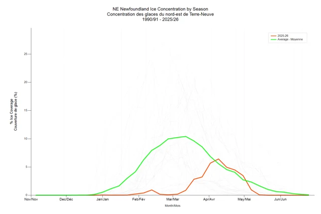
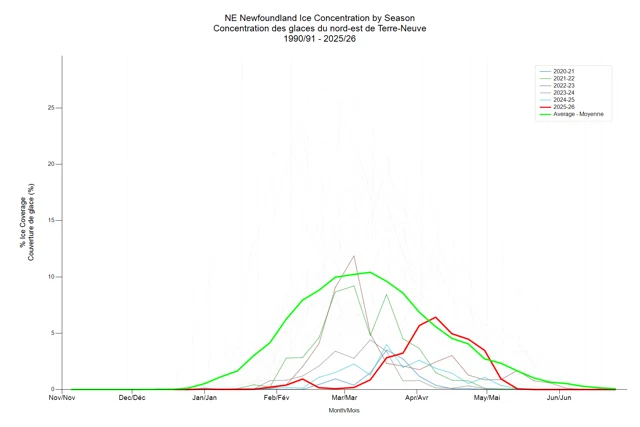

[← All programs](../README.md#program-catalogue)

NE Newfoundland / Choose a period

# NE Newfoundland — Choose a period

Choose a starting season and cutoff date, then create both charts from the selected data.

Windows C# · Two PNG charts · Bilingual chart labels

[Download the programs (.zip)](https://github.com/karagang/CIS-tools/raw/refs/heads/main/Overlay%20Charts/docs/downloads/east-coast-csharp.zip) · [View C# source](https://github.com/karagang/CIS-tools/blob/main/Overlay%20Charts/NewFoundLand/NFLND-Overlay-both.cs)

[Open the Python version guide →](nflnd-overlay-both-python.md)

## What the program shows

Weekly ice coverage is plotted as a percentage, with each season aligned from November to June. Each run creates two views of the same data and saves them before opening the chart windows.

[](../assets/charts/NFLND-Overlay-both-single.png)

**Latest season + average**

The latest season is orange-red, the supplied average is green, and earlier seasons form a light gray background. Select the image to see the full-size PNG.

[](../assets/charts/NFLND-Overlay-both-lastFive.png)

**Latest + five previous seasons**

The latest season is red. Five preceding available seasons have distinct colors, alongside the average and historical background. Select the image to see the full-size PNG.

These example plots use 1990/91–2025/26 from the included CSV. They are examples, not a live data feed.

## Run this program

Extract the ZIP first. Open the `NewFoundLand` folder and double-click `NFLND-Overlay-both.exe`, or run this command from the extracted package folder:

```powershell
.\NewFoundLand\NFLND-Overlay-both.exe
```

**Inputs**

Starting season (for example, `1990-91`), cutoff date (`20260630`), and CSV filename. Press Enter at the CSV prompt to use `weekly_NE-NFLND.csv`.

**Season range**

The first selected season through the last available season on or before your cutoff date. The title reflects the selected seasons.

**Saved charts**

`NewFoundLand\output\NFLND-Overlay-both-single.png`

`NewFoundLand\output\NFLND-Overlay-both-lastFive.png`

**Run again**

The program replaces its own two PNGs. Other programs' images have different filenames.

For saving without opening plot windows, append `--no-show`. The period and CSV prompts still appear.

```powershell
.\NewFoundLand\NFLND-Overlay-both.exe --no-show
```

## Data and requirements

Runs on Windows with .NET Framework and its charting library. Python and additional NuGet packages are not required. Keep the regional CSV beside the executable and replace it when new observations are available.

The green line uses the CSV's `Average` column, averaged by normalized calendar date. It does not calculate a new climatology from the concentration measurements. Historical season labels are preserved.

[Full setup and rebuild instructions](https://github.com/karagang/CIS-tools/blob/main/Overlay%20Charts/README.md) · [Shared charting source](https://github.com/karagang/CIS-tools/blob/main/Overlay%20Charts/Shared/OverlayCharts.cs)

[← All programs, source, and chart previews](../README.md)
